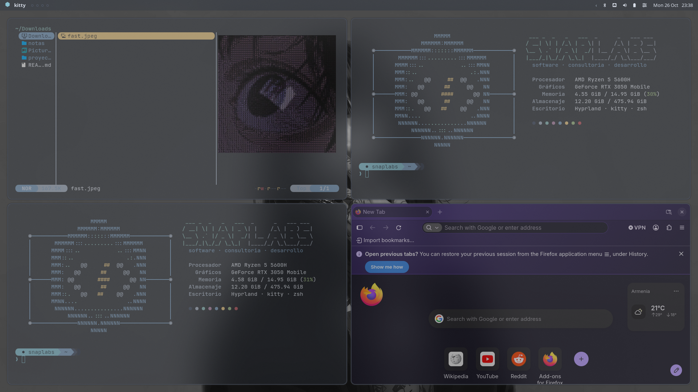

<div align="center">

# ⬢ snaplabs · dotfiles

**Arch Linux + Hyprland** con estética macOS y un tema central:
cambias los colores en **un solo archivo** y se actualiza todo el escritorio.




</div>

---

## Contenido

- [Componentes](#componentes)
- [El tema central](#el-tema-central)
- [Estructura del repositorio](#estructura-del-repositorio)
- [Instalación](#instalación)
- [Atajos principales](#atajos-principales)
- [Notas del equipo](#notas-del-equipo)

---

## Componentes

| Función | Herramienta |
|---|---|
| Gestor de ventanas | [Hyprland](https://hypr.land) (config en **Lua**) |
| Barra | [Waybar](https://github.com/Alexays/Waybar), estilo barra de menús de macOS con cajón de monitores |
| Terminal | [kitty](https://sw.kovidgoyal.net/kitty/) + JetBrains Mono Nerd Font |
| Shell | zsh + autosuggestions, syntax-highlighting, fzf y zoxide |
| Prompt | [Starship](https://starship.rs), en bloques |
| Notificaciones | [mako](https://github.com/emersion/mako), tarjetas tipo macOS con íconos WhiteSur |
| Bloqueo / inactividad | hyprlock + hypridle |
| Menú de apagado | [wlogout](https://github.com/ArtsyMacaw/wlogout) |
| Lanzador | hyprlauncher (tema vía hyprtoolkit) |
| Fondos | hyprpaper (rotación con `Super + W`) |
| Explorador | [Yazi](https://yazi-rs.github.io) |
| Ficha del sistema | fastfetch con logo propio |
| Íconos | WhiteSur |
| Paleta | [Nord](https://www.nordtheme.com) con transparencias y desenfoque |
| Juegos | Steam + Proton · `prime-run` para la RTX |

---

## El tema central

La idea principal: **ninguna herramienta tiene sus colores escritos a mano**.

```
.config/theme/palette.sh    ← se edita aquí (colores, transparencias, blur)
          │
          ▼
.config/theme/apply.sh      ← genera los archivos de cada herramienta y recarga todo
          │
          ├── generated/colors.lua         → Hyprland (bordes, opacidad, blur)
          ├── generated/colors.css         → Waybar y wlogout
          ├── generated/colors.conf        → hyprlock y hyprlauncher (hyprtoolkit.conf)
          ├── generated/kitty-colors.conf  → kitty (16 colores + transparencia)
          ├── mako/config                  ← config.base + colores
          └── starship.toml                ← starship.base.toml + colores
```

Para cambiar el tema:

```bash
nano ~/.config/theme/palette.sh
~/.config/theme/apply.sh
```

Los archivos generados **no están en el repositorio**: se crean al ejecutar `apply.sh`.
Las herramientas de terminal (fastfetch, Yazi, bat, eza) heredan los colores de kitty.

| Variable | Controla |
|---|---|
| `BG` `SURFACE*` `FG*` `ACCENT*` … | Colores de todo el escritorio |
| `OPACITY` | Terminal |
| `BAR_OPACITY` | Waybar |
| `NOTIF_OPACITY` | Notificaciones |
| `WIN_OPACITY_ACTIVE` / `_INACTIVE` | Ventanas con y sin foco |
| `BLUR` · `BLUR_SIZE` · `BLUR_PASSES` | Desenfoque |

---

## Estructura del repositorio

```
~
├── .zshrc · .bashrc
├── README.md
├── notas/                     # documentación del equipo (paquetes, atajos, mapa de config)
└── .config/
    ├── theme/                 # palette.sh + apply.sh  ← el corazón del tema
    ├── hypr/                  # hyprland.lua, hyprlock, hypridle, hyprpaper, hyprtoolkit, scripts/
    ├── waybar/                # config.jsonc, style.css, scripts/ (GPU y ventiladores)
    ├── wlogout/               # layout y style.css
    ├── mako/                  # config.base
    ├── kitty/                 # kitty.conf
    ├── fastfetch/             # config.jsonc + logo.txt
    ├── starship.base.toml
    ├── system/                # copia de los archivos de /etc (ver Instalación)
    └── assets/                # capturas
```

---

## Instalación

> Pensado para **mi equipo** (HP Victus 15, Ryzen 5 5600H + RTX 3050). Algunas partes
> (ventiladores `hp-wmi`, monitores, NVIDIA) son específicas de ese hardware.

### 1. Paquetes

```bash
sudo pacman -S hyprland hyprlock hypridle hyprpaper hyprlauncher hyprpolkitagent \
  xdg-desktop-portal-hyprland xdg-desktop-portal-gtk waybar mako libnotify kitty \
  zsh zsh-autosuggestions zsh-syntax-highlighting zsh-completions starship \
  eza bat fastfetch fzf zoxide yazi ffmpeg 7zip jq poppler fd ripgrep imagemagick resvg \
  noto-fonts ttf-jetbrains-mono-nerd ttf-nerd-fonts-symbols \
  brightnessctl playerctl wl-clipboard grim slurp power-profiles-daemon
sudo pacman -S steam nvidia-prime     # juegos (requiere multilib)
yay -S wlogout whitesur-icon-theme
```

La lista completa, con el motivo de cada paquete, está en [`notas/arch-paquetes.md`](notas/arch-paquetes.md).

### 2. Clonar (repositorio *bare*)

Los archivos viven directamente en `$HOME`, sin enlaces simbólicos:

```bash
git clone --bare git@github.com:SebasXayala/dotfiles.git ~/.dotfiles
alias dot='git --git-dir=$HOME/.dotfiles --work-tree=$HOME'
dot checkout            # si se queja de archivos existentes, muévelos y repite
dot config status.showUntrackedFiles no
printf '.config/theme/generated/\n.config/mako/config\n.config/starship.toml\n' >> ~/.dotfiles/info/exclude
```

### 3. Generar el tema

```bash
~/.config/theme/apply.sh
chsh -s /usr/bin/zsh
```

### 4. Archivos del sistema (fuera de `$HOME`)

```bash
sudo cp ~/.config/system/99-hp-fan.rules /etc/udev/rules.d/          # ventiladores sin sudo
sudo mkdir -p /etc/systemd/logind.conf.d
sudo cp ~/.config/system/tapa.conf /etc/systemd/logind.conf.d/       # tapa: bloquear / suspender
sudo systemctl enable nvidia-suspend nvidia-resume nvidia-hibernate  # HDMI tras suspender
```

Cierra la sesión y vuelve a entrar en Hyprland.

---

## Atajos principales

| Atajo | Acción |
|---|---|
| `Super + T` | Terminal |
| `Super + Q` | Cerrar ventana |
| `Super + R` | Lanzador |
| `Super + E` | Explorador (Yazi) |
| `Super + F` / `Super + Shift + F` | Maximizar / pantalla completa |
| `Super + L` | Bloquear |
| `Super + W` | Siguiente fondo |
| `Super + Shift + S` · `Print` | Captura de zona / pantalla |
| `Super + Shift + ←↑↓→` | Mover ventana |
| `Super + Ctrl + ←↑↓→` | Cambiar tamaño |
| `Super + 1…0` | Cambiar de escritorio |

Todos los atajos están en [`notas/arch-atajos.md`](notas/arch-atajos.md).

---

## Notas del equipo

| Nota | Contenido |
|---|---|
| [`arch-paquetes.md`](notas/arch-paquetes.md) | Cada paquete instalado y para qué sirve; cambios del sistema |
| [`arch-atajos.md`](notas/arch-atajos.md) | Atajos y comandos de cada herramienta |
| [`arch-mapa-config.md`](notas/arch-mapa-config.md) | Qué archivo controla qué, y qué sale de la paleta |
| [`arch-mantenimiento.md`](notas/arch-mantenimiento.md) | Rutina de actualización, snapshots y qué hacer si algo falla |

---

<div align="center">

Paleta [Nord](https://www.nordtheme.com) · íconos [WhiteSur](https://github.com/vinceliuice/WhiteSur-icon-theme) · hecho por [SebasXayala](https://github.com/SebasXayala) · **⬢ snaplabs**

</div>
